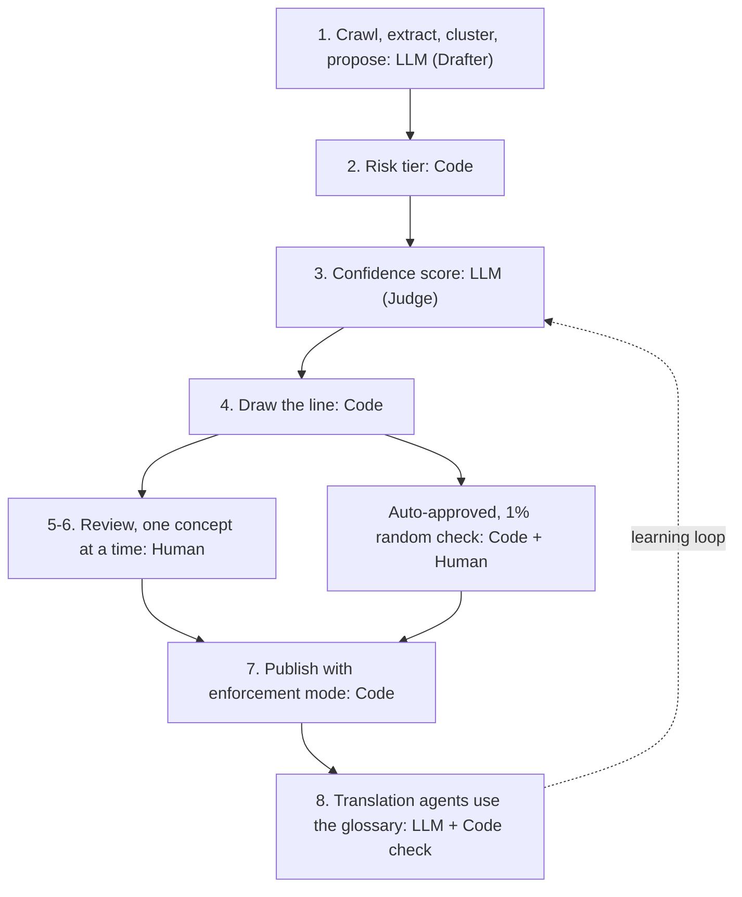

# Glossary review

A prototype of a glossary-review workflow for localisation. A new client can bring about 3,000 terms in 12 locales: 36,000 entries. A linguist judges about 30 entries an hour with the right context, so a day per locale covers roughly 240 entries, about 1 in 12. This project shows how a human sees about 1 entry in 12 and the system picks which: LLMs draft and score, code ranks by risk, and the linguist's hours go where a mistake costs most.


Design write-up: LINK_TO_DESIGN_DOC

## Try it

**Demo (no key needed):** https://longlivedong.github.io/glossary-review/ runs on sample data for a fictional client.

**Live, with your own key:**
1. Clone the repo.
2. Copy `.env.example` to `.env` and add your own free key (see presets below).
3. Run `node server.mjs` (Node 18 or newer; no `npm install` needed).
4. Open http://localhost:8787 and paste a website URL on the "Run on a website" tab.

To try the live flow without a key, run `LLM_PROVIDER=mock node server.mjs`: pages are really fetched, but the model answers are canned. Without a key and without mock mode, the server shows the sample run with a note about the missing key.

| Provider | Base URL | Notes |
|---|---|---|
| Gemini | `https://generativelanguage.googleapis.com/v1beta/openai` | Free tier available |
| NVIDIA | `https://integrate.api.nvidia.com/v1` | Free tier available |
| Groq | `https://api.groq.com/openai/v1` | Free tier available |
| OpenRouter | `https://openrouter.ai/api/v1` | Free models available |
| Ollama (local) | `http://localhost:11434/v1` | Runs on your machine, no key |

Any OpenAI-compatible endpoint works. Check each provider's current limits and terms.

## How it works



The Drafter groups variants ("sign in", "log in", "login") into one concept and proposes a rendering per locale, with a one-line reason and the source sentence. The Judge, a separate call, scores confidence from four checks: imported sources agree, sibling locales agree, style-guide fit, and self-consistency (the same answer asked three ways).

## Why a pipeline, not an agent

This is a fixed sequence of narrow LLM calls run by code. It is not an autonomous agent. The order of steps, the tier, the ranking and the line are deterministic, so a run is predictable, auditable and testable. Each LLM call has one job and a checkable output. If a result looks wrong, you can see which call produced it.

## The rules

Tier comes from the type of term. Industry only shifts defaults upward (for example, ordinary words in healthcare become High).

| Tier | Term types | Default enforcement |
|---|---|---|
| Critical | Safety and dosage wording, legal disclaimers, regulator-defined terms | hard |
| High | Brand and product names, buttons and labels, prices, returns, payment | hard |
| Standard | Category names, marketing phrases, ordinary industry words | guidance |
| Low / do-not-translate | Codes, SKUs, brand names kept in source | hard (keep as is) |

- **Priority** = tier weight x (1 - confidence) x log(1 + frequency). Weights: Critical 4, High 3, Standard 2, Low 1.
- **Floors** are always reviewed: every Critical, every low-confidence High, a sample of High, low-confidence Low.
- **The line** falls where the reviewer's hours run out: floors first, then the highest priority until the budget is used.
- **Below the line**: auto-approved, visible and reversible. A 1% random sample is checked by a human.
- **Enforcement**: hard means the translation must match; guidance means preferred.
- **Overrides**: changing the Drafter on a Critical entry goes to a second linguist, then the locale lead decides. "Ask client" is for brand questions only and never blocks launch.

## Assumptions

- 30 entries per hour with context, 8 hours per locale, so capacity is 240, about 8% of 3,000.
- The demo header reads: 2,860 of 3,000 concepts approved automatically, 140 need you, 29 in the random check, about 4.5 hours at your pace. The random check is drawn from the auto-approved entries, so it never uses the review budget.

## What's real vs simulated

| Real | Simulated |
|---|---|
| Crawl (at most 10 pages, robots.txt respected) | The second linguist and locale lead |
| LLM calls | Client replies to questions |
| Tiering, ranking and the line (code) | Applying learning to a next run |
| Review state and decisions | |
| Export | |

## Privacy and cost

The API key stays in `.env` on your machine and never reaches the browser. A 10-page, 100-concept run makes about 23 LLM calls (10 extract, 1 cluster, 3 × 2 drafts, 2 sibling, 2 judge, 1–2 preview) and sends roughly 60k prompt tokens and gets back about 10k. Free tiers are usually enough, but they may be rate-limited, so the browser spaces requests (`LLM_MIN_GAP_MS`, default 4 s) and backs off on 429s; a run takes 2–3 minutes.

## Project structure

```
index.html              page shell; no build step, no CDN
css/                    app.css (tokens, shared), review.css (header, queue, card), live.css (setup, preview, learning)
js/app.js               boot: demo vs live detection, tabs, toasts
js/state.js             the store: run, decisions, undo, persisted to localStorage
js/rules.js             tiers, priority, floors, the line, publish rules (pure functions)
js/schema.js            shared data shapes
js/ui/                  one module per view: header, queue, card, auto, publish, preview, learning, setup, progress
js/pipeline.js          the fixed pipeline: crawl, extract, cluster, draft ×3, sibling, judge, line; enforcement preview
js/prompts.js           one prompt builder per LLM task
js/llm.js               browser client for the local server: rate-limit queue, retries, JSON repair
js/mock-llm.js          canned answers for LLM_PROVIDER=mock and the tests
js/demo-data.js         the sample run (fictional client)
js/llm-contract.md      server and browser interfaces
server.mjs              local server: static files, /api/health, /api/fetch, /api/llm
.env.example            provider presets; copy to .env
samples/                template glossary CSV
docs/                   architecture diagrams, screenshot
tests/                  node:test suites (rules, demo data, pipeline with the mock, server)
```

## Tests

```
npm test
```

Runs the rules, demo-data, pipeline (against the mock LLM) and server tests with Node's built-in test runner. No dependencies.

All names and data in the sample run are fictional.
