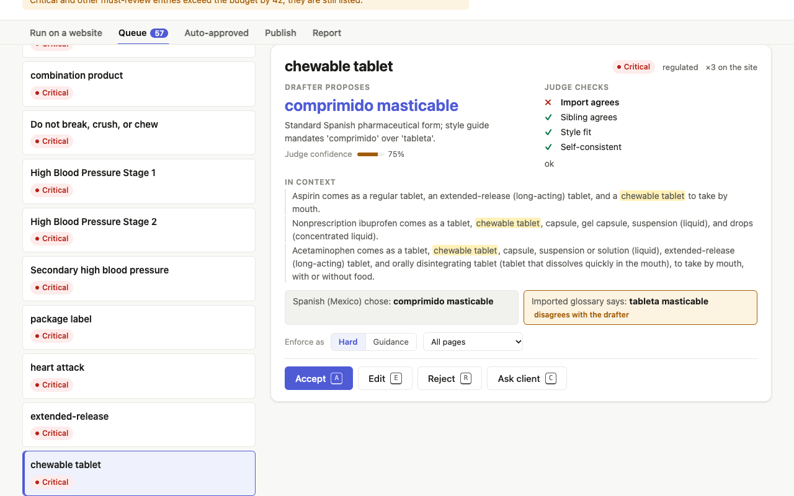
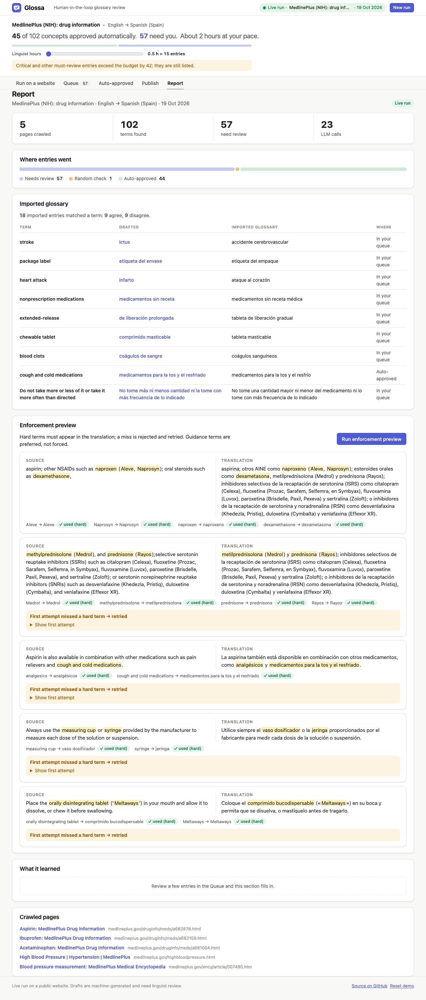
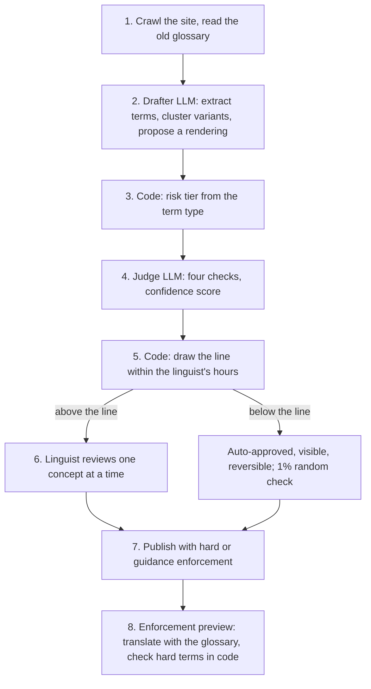

# Glossa

**Human-in-the-loop glossary review: AI drafts and judges, code decides what a linguist sees.**

A new localisation client can bring about 3,000 terms in 12 locales, which is 36,000 glossary entries. A linguist judges about 30 entries an hour with the right context, so a day per locale covers roughly 240 entries, about 1 in 12. Glossa is a working prototype of how a human sees only that 1 in 12 and the system picks which. An LLM drafts every entry and a second LLM judges it. Code ranks the entries by risk and uncertainty. The linguist's hours go where a mistake costs most, and everything else is approved automatically but stays visible and reversible.



## Run it on any website

You need Node 18 or newer and a free API key. No `npm install` is needed.

```bash
git clone https://github.com/longlivedong/glossa.git
cd glossa
cp .env.example .env      # then add your key (see below)
node server.mjs           # open http://localhost:8787
```

1. Open **Run on a website** and paste a site's URL. You can also list specific pages, upload an old glossary (CSV) and paste a style guide.
2. Or click **Try an example**. It fills in one of the two ready-made tests in [samples/TEST-KIT.md](samples/TEST-KIT.md): a public health site and a sandbox bookshop.
3. Review the queue, then see the **Report** tab for what the run found.

Without a key, the app opens on a fictional sample run so you can still try the review flow. `LLM_PROVIDER=mock node server.mjs` runs the live flow with canned model answers.

### Keys and free tiers

Any OpenAI-compatible endpoint works. Set it in `.env`:

| Provider | `LLM_BASE_URL` |
|---|---|
| Google Gemini | `https://generativelanguage.googleapis.com/v1beta/openai` |
| NVIDIA | `https://integrate.api.nvidia.com/v1` |
| Groq | `https://api.groq.com/openai/v1` |
| OpenRouter | `https://openrouter.ai/api/v1` |
| Ollama (local, no key) | `http://localhost:11434/v1` |

A run of 5–10 pages makes about 20–25 model calls. Free Gemini keys allow about 5 requests a minute and 20 a day per model, so use these settings:

```
LLM_MODEL=<a flash model>          # drafter
JUDGE_MODEL=<a different model>    # judge: its own quota, and an independent second opinion
LLM_REASONING_EFFORT=low           # stops "thinking" models spending the token limit
LLM_MIN_GAP_MS=13000               # about 4 requests a minute
```

If a quota or "high demand" error stops a run, press **Retry**. Finished steps are cached, so the run resumes where it stopped. The key stays in `.env` on your machine and never reaches the browser.

## Results from a real run

A test on 5 [MedlinePlus](https://medlineplus.gov/) drug and blood-pressure pages (US National Library of Medicine), English → Spanish (Spain), used a free Gemini key. The old glossary came from MedlinePlus's own Spanish edition, which is written in Latin American Spanish.

| Measure | Result |
|---|---|
| Terms found | 120, clustered into 102 concepts |
| Model calls | 23 (5 extract, 1 cluster, 9 draft, 3 sibling locale, 3 judge, 2 enforcement preview) |
| Sent to a linguist | 57: all 53 Critical terms plus a 10% sample of High |
| Auto-approved | 44, plus 1 in the random check |
| Old glossary | 9 of 18 entries caught as wrong for Spain (*tableta → comprimido*, *ataque al corazón → infarto*, *empaque → envase*); 8 of those went to the linguist |
| Enforcement preview | 4 of 5 first translations missed a required term; the code check caught each one and the retry fixed it |

The run also exposed two problems, both now fixed:
- **The judge was overconfident**, averaging 0.97. Code now caps its score whenever one of its own checks fails.
- **The 10% High-tier sample was drawing 24%**, because of a hashing bias. It now draws 10%.



## How it works



- **Drafter.** It groups variants ("sign in", "log in", "login") into one concept. For each concept it proposes a rendering with a one-line reason and the source sentence, and drafts it 3 ways for the self-consistency check. It never sees the old glossary, so agreement with it is an independent signal.
- **Judge.** A different model scores each entry with four checks: the old glossary agrees, the sibling locale agrees, the style guide fits, and the 3 phrasings agree. Code then caps the score when a check fails.
- **Why a pipeline, not an agent.** Code runs a fixed sequence of narrow model calls, so every run is predictable, auditable and testable. If a result looks wrong, you can see which call produced it.

## The rules

| Tier | Term types | Default enforcement |
|---|---|---|
| Critical | Safety and dosage wording, legal disclaimers, regulator-defined terms | hard |
| High | Brand and product names, buttons and labels, prices, returns, payment | hard |
| Standard | Category names, marketing phrases, ordinary industry words | guidance |
| Low / do-not-translate | Codes, SKUs, names kept in the source language | hard (keep as is) |

- **Tier** comes from the type of term. Industry only shifts defaults upward.
- **Priority** = tier weight × (1 − confidence) × log(1 + frequency), with weights Critical 4, High 3, Standard 2, Low 1.
- **Floors** are always reviewed: every Critical entry, every High entry below 0.6 confidence, a 10% sample of the other High entries, and Low entries below 0.6 confidence.
- **The line** is drawn floors first, then by priority until the linguist's hours (30 entries an hour) are used. Floors that exceed the budget are flagged, never auto-approved.
- **Linguist actions:** accept, edit (and apply to the whole concept), reject with a reason, or ask the client. Overriding the drafter on a Critical entry escalates it.

## What's real and what's simulated

| Real | Simulated or not built |
|---|---|
| Crawl (up to 10 pages, robots.txt respected) | Second linguist and locale lead (shown as an "Escalated" status) |
| Every model call and the code rules | Client replies to questions |
| Review decisions, undo, reopen, export (JSON, CSV) | Learning applied to the next run (shown, not fed back) |
| Enforcement check on translated sentences | TBX and translation-memory import (CSV only) |

## Deploying

The repo also deploys to Vercel as static files plus three functions (`api/health`, `api/fetch`, `api/llm`) that reuse the local server's code. Set the same variables as in `.env` in the project's environment settings. You can also set `MAX_PAGES` to cap pages per run. On a hosted deployment the model proxy forwards only Glossa's own prompts, with size and token limits, so the owner's key can't be used as a general-purpose endpoint.

## Project structure

```
index.html            page shell; no build step, no dependencies, no CDN
css/                  app.css (tokens, shared), review.css (header, queue, card), live.css (setup, report)
js/rules.js           tiers, priority, floors, the line, calibration, publish rules (pure functions)
js/pipeline.js        the fixed pipeline: crawl, extract, cluster, draft ×3, sibling, judge, line; enforcement preview
js/prompts.js         one prompt per model task
js/llm.js             browser client: rate limiting, retries, JSON repair, quota messages
js/state.js           review state, undo, saved in the browser
js/ui/                one module per view: header, queue, card, auto-approved, publish, report, setup, progress
js/demo-data.js       the fictional sample run
server.mjs            local server: static files, /api/health, /api/fetch, /api/llm
api/, vercel.json     Vercel functions (same handlers as server.mjs)
samples/              test kit, old glossaries and style guides for the two tests, CSV template
docs/                 architecture diagrams and screenshots
tests/                node:test suites: rules, demo data, pipeline (mock model), server
```

## Tests

```bash
npm test
```

There are 45 tests, run with Node's built-in test runner. They need no dependencies or network access.

All names and data in the built-in sample run are fictional. MedlinePlus content is in the public domain, courtesy of the US National Library of Medicine.
