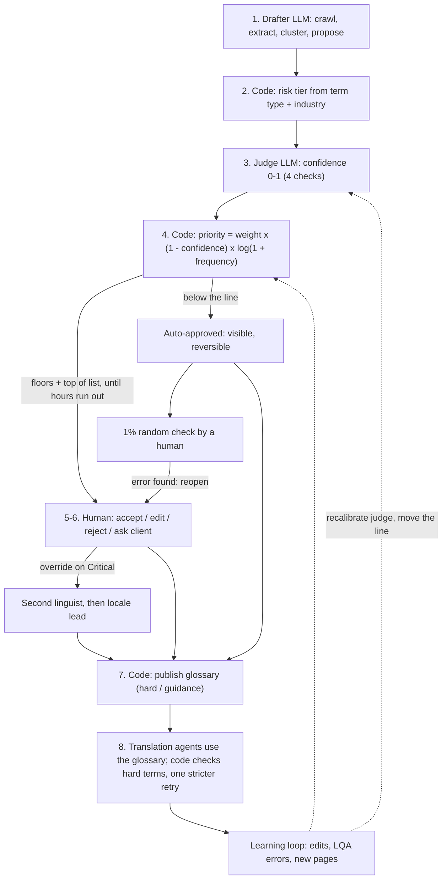
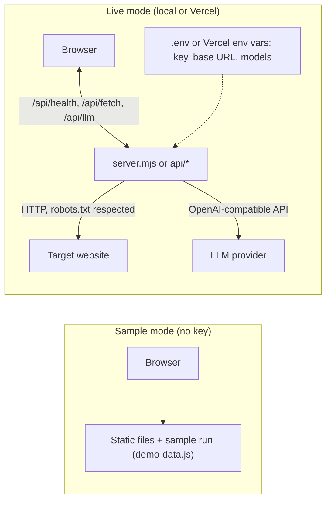
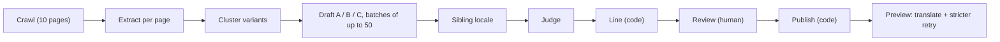

# Architecture

Three views of the same system: what the process does, where it runs, and which calls it makes.

## 1. System flow

Eight steps, from crawl to enforcement. The tier (step 2) and the line (step 4) are decided by code, never by a model. Humans review the concepts above the line; everything below it is auto-approved but stays visible and reversible, and a 1% random sample of it is checked by a human.

## 2. Runtime: demo vs live

Without a configured key the app shows a bundled sample run. Live mode adds a server that holds the key, fetches pages and forwards LLM calls; the browser never sees the key. The server runs locally (`node server.mjs`) or as three Vercel functions that reuse the same handlers.

## 3. Per-run call sequence

The browser orchestrates a fixed sequence of narrow calls. Each box is one kind of call, and code decides what happens next.

Calls for a 10-page, 100-concept run. Concepts go in even batches of up to 50 (100 → 2 × 50), so the largest request (the judge) stays near 8k tokens including its output budget. Each batch is followed by one extra call only if the model skipped items, and an invalid JSON reply gets one repair call.

| Step | Kind | Calls | Prompt tokens (approx.) |
|---|---|---|---|
| Crawl | HTTP fetch | 10 (no LLM) | 0 |
| Extract per page | LLM (Drafter) | 10 | 16.5k |
| Cluster | LLM (Drafter) | 1 | 1k |
| Draft A, B, C | LLM (Drafter) | 6 (3 per batch) | 25k |
| Sibling locale | LLM (Drafter) | 2 | 5k |
| Judge | LLM (Judge) | 2 | 10k |
| Line, review, publish | Code / Human | 0 | 0 |
| Preview | LLM (Drafter) | 1-2 | 1k |
| Total | | about 23 | about 60k, plus about 10k completion |

What keeps it small: navigation and footer text repeated across pages is sent to the extractor once; each concept carries at most two context sentences, cut to a 160-character window around the term; payloads use one- or two-letter keys; the style guide (capped at 1,200 characters) goes once per batch; the judge gets the B and C phrasings only when they differ from the proposal and never sees the drafter's reasoning; and every task has its own output cap.
